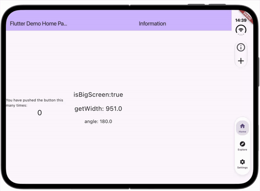
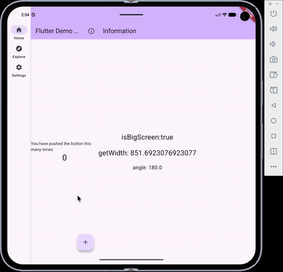

# foldable_devices_ui

Adaptive Flutter UI widgets and controllers for **iPhone Duo** as well as **Android large-screen and foldable devices**.

## Demo

| iPhone Duo | Android Foldable |
| :---: | :---: |
|  |  |

## Platform Behavior

| Platform / State | Breakpoint | `DuoSafeArea` | `DuoTabBar` (`BottomNavigationBar`) | `DuoTabBar` (`FloatingActionButton`) | `ToolBar` & `AppBarBackButtonWidget` |
| :--- | :--- | :--- | :--- | :--- | :--- |
| **iPhone Duo (Unfolded)** | `width >= 890` | Left/right `SafeArea` + side `backgroundColor` strips | Relocates to side strip as `DuoVerticalBottomNav` | Moves into native UIKit toolbar | Moves into native UIKit toolbar (2+ actions grouped into `UIMenu`) |
| **iPhone Duo (Folded)** | `width < 890` | Left/right `SafeArea` + side `backgroundColor` strips | Relocates to side strip as `DuoVerticalBottomNav` | Moves into native UIKit toolbar | Moves into native UIKit toolbar |
| **Android Foldable / Large Screen** | `width >= 600` | Hosts leading `NavigationRail` + `VerticalDivider` | Converts to leading `NavigationRail` | Standard `FloatingActionButton` | Standard Flutter widgets |
| **Compact Screen** | `< 600` (Android) / `< 890` (iOS) | Standard rendering | Standard `BottomNavigationBar` | Standard `FloatingActionButton` | Standard Flutter widgets |

## Classes & Widgets

| Class / Enum | Category | Summary |
| :--- | :--- | :--- |
| `DuoSafeArea` | Widget | Root wrapper for `MaterialApp` / `MaterialApp.router` (`material_ui` and `flutter/material.dart`). Manages iPhone Duo side safe areas, native toolbar sync, route wrapping (`DuoSafeArea.route`), and large-screen `NavigationRail` hosting. |
| `DuoTabBar` | Widget | Wraps `BottomNavigationBar` or `FloatingActionButton`. Relocates bottom navigation into `DuoVerticalBottomNav` (iPhone Duo) or `NavigationRail` (Android large screens), and moves FAB to the native toolbar on iPhone Duo. |
| `DuoVerticalBottomNav` | Widget | Vertical navigation bar rendered in the iPhone Duo side safe-area strip. |
| `ToolBar` | Widget | Hosts `IconButton`, `BackButton`, `FloatingActionButton`, `BottomNavigationBar`, and `NavigationBar` in the native iPhone Duo toolbar; falls back to Flutter widgets on other platforms. |
| `AppBarBackButtonWidget` | Widget | `AppBar.leading` back button that moves into the native toolbar on iPhone Duo and renders a standard back `IconButton` on other platforms. |
| `DeviceWidth` | Controller | Switches between 1-pane and 2-pane layouts (`updateScreen`) based on width and hinge angle, with width/breakpoint helpers (`getWidth`, `isBigScreen`). |
| `RowItem` | Data Model | Holds `leftWidget` and `rightWidget` for `DeviceWidth.updateScreen`. |
| `DeviceAngle` | Controller | Provides a broadcast `Stream<double>` (`getAngle`) of hinge angles (`0.0`–`180.0`) on Android and iOS, replaying the latest value to new subscribers. |
| `DeviceWidthState` | State (`ChangeNotifier`) | Tracks whether the viewport width meets the large-screen threshold (`>= 890` on iOS, `>= 600` on Android). |
| `AppAction` / `AppActionRole` | Data Model / Enum | Action representation (`back`, `primary`, `action`, `destination`) synchronized with the native iPhone Duo toolbar. |
| `DuoBottomNavEntry` / `DuoBottomNavItem` / `DuoBottomNavRegistry` | Data Model / State | Models and registry for hosting `BottomNavigationBar` items in `DuoVerticalBottomNav` or `NavigationRail`. |

## Flags, Properties & Methods

| Member | Owner | Type | Default | Description |
| :--- | :--- | :--- | :--- | :--- |
| `isLargeScreen` | `AppActionScope` | `bool` | `false` | `true` when width meets the large-screen threshold (`>= 600` on Android, `>= 890` on iOS). |
| `isIphoneDuo` | `AppActionScope` | `bool` | — | `true` when running on iPhone Duo. |
| `isEffectiveDuo` | `AppActionScope` | `bool` | `false` | `true` on iPhone Duo in both folded and unfolded states. |
| `shouldRelocateBottomNav` | `AppActionScope` | `bool` | `false` | `true` when bottom navigation relocates (`isIphoneDuo \|\| isLargeScreen`). |
| `useModernMaterial` | `AppActionScope` | `bool` | `false` | `true` when `DuoSafeArea` wraps a `material_ui` `MaterialApp`. |
| `isBigScreen(context)` | `DeviceWidth` | `bool` | — | Updates `DeviceWidthState` and returns whether the screen is large. |
| `getWidth(context)` | `DeviceWidth` | `double` | — | Returns the current logical screen width. |
| `isLimited` | `DeviceWidth.updateScreen` | `bool` | `false` | When `true`, switches 2-pane split between `3:7` (`angle > 175°`) and `5:5` (`angle <= 175°`). |
| `popOnBigScreen` | `DeviceWidth.updateScreen` | `bool` | `true` | Pops a pushed detail route automatically when expanding to a large screen. |
| `state` | `DeviceWidth` / `DeviceWidthState` | `DeviceWidthState` / `bool` | `false` | Current large-screen state notifier / flag. |
| `getAngle()` | `DeviceAngle` | `Stream<double>` | — | Broadcast stream of hinge angles (`0.0`–`180.0`) with latest-value replay. |
| `exception` | `DuoSafeArea` | `List<Type>` | `const []` | Page types excluded from automatic side `SafeArea` and `NavigationRail` wrapping. |
| `backgroundColor` | `DuoSafeArea` | `Color?` | `null` | Background color for the left and right safe-area strips on iPhone Duo. |
| `route(...)` / `wrapPage(...)` | `DuoSafeArea` | static methods | — | Wraps imperatively pushed routes or custom pages for `DuoSafeArea` handling. |
| `useIndependence` | `DuoTabBar` / `DuoBottomNavEntry` | `bool` | `false` | Enables independent floating styling on `DuoVerticalBottomNav` or marks a FAB action independent. |
| `isEnabled` / `isSelected` / `isIndependent` | `AppAction` | `bool` | `true` / `false` / `false` | Action interactivity, selection, and independence flags. |
| `priority` | `AppAction` | `int` | `0` | Ordering priority (`back: 100`, `primary: 80`, `destination: 70`, `action: 50`). |

## License

[MIT License](LICENSE)
